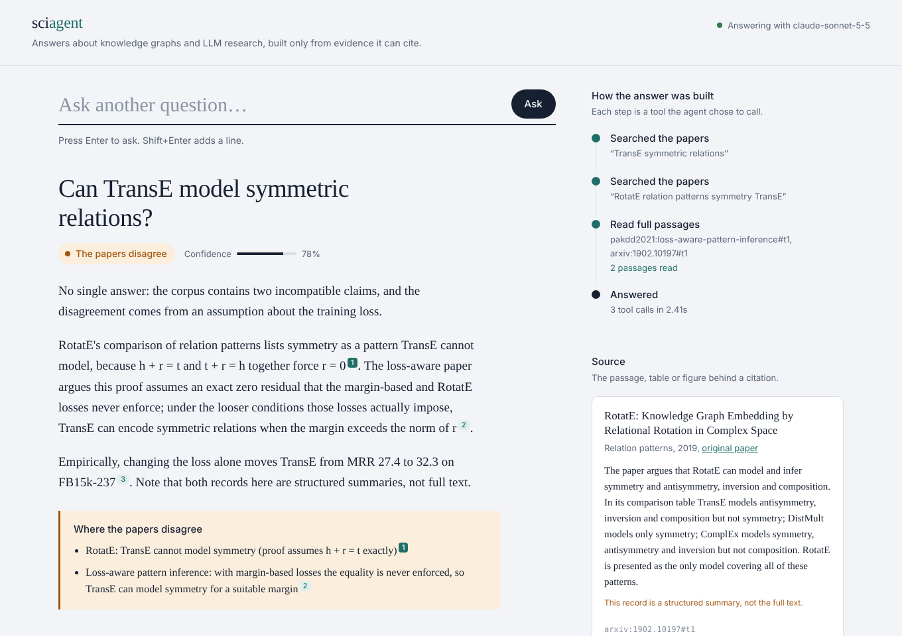

# sciagent — an agentic research assistant for knowledge-graph & LLM research

A small agentic AI system that collects scientific papers, indexes their text, tables and figures, and answers
research questions with **Claude** (Anthropic API, tool use), choosing its own tools: literature retrieval, figure
inspection (vision), Python, a benchmark-leakage analysis, and NL→SPARQL querying of the Open Research Knowledge
Graph (ORKG). Every claim must cite evidence the agent actually retrieved; conflicting or missing evidence is
reported as such rather than smoothed over.

**Showcase topic:** the research area of Sahar Vahdati — knowledge-graph embeddings / link prediction and
knowledge graphs + LLMs for factual reliability — including a real published disagreement (RotatE vs.
*Loss-Aware Pattern Inference* on whether TransE can model symmetric relations).

**Benchmark testing** follows LLM-based NL→SPARQL scientific QA on **SciQA** (official train/valid/test split),
**without any training or fine-tuning**: the train split is only a pool of retrieved few-shot examples.

| Doc | What's in it |
|---|---|
| [docs/DESIGN.md](docs/DESIGN.md) | Architecture, design choices, how each review criterion is addressed |
| [docs/EVALUATION.md](docs/EVALUATION.md) | Test suite, eval harness, results (retrieval, SciQA, leakage analysis) |
| [docs/EXAMPLES.md](docs/EXAMPLES.md) | Example questions, tool traces and outputs |
| [docs/AI_USAGE.md](docs/AI_USAGE.md) | How a coding agent (Claude) was used to build this, and what was checked by hand |

## Quick start

```bash
python -m venv .venv && source .venv/bin/activate
pip install -r requirements.txt
export ANTHROPIC_API_KEY=sk-ant-...          # only needed for the agent / LLM evals
export SCIAGENT_MODEL=claude-sonnet-5-5      # optional; any Claude model with tool use + vision

make build        # download WN18/WN18RR/FB15k-237, run leakage analysis -> report PDF, ingest + index corpus
make test         # 96 offline tests (fake Claude client), 4 live tests skipped without an API key

python -m sciagent serve                     # web interface on http://localhost:8000
python -m sciagent ask "Can TransE model symmetric relations?" -v
python -m sciagent ask "In Figure 1 of the leakage report, which dataset has the lowest bars?" --json
python -m sciagent search "ConvKB CapsE random protocol"        # retrieval only, no LLM
```

### Web interface

`python -m sciagent serve` (or `make serve`) opens a local page at http://localhost:8000. Type a question and watch the
agent's tool calls appear on the right as it works; the answer shows a verdict (supported / the papers disagree /
not enough evidence), numbered citations, and a "where the papers disagree" block. Clicking a citation opens the exact
passage, table or figure image behind it. Without an API key the page runs in search-only mode and shows the
retrieved passages. Standard library only, no extra install.



The screenshot uses a scripted demo run (no API key was available while building); with a key the same page shows
Claude's real answers. Fonts load from Google Fonts when online.

### Ask about a specific paper (including one not in the corpus)

```bash
python -m sciagent add path/to/paper.pdf          # or an arXiv id: 2508.16983, or a PDF link
python -m sciagent ask "What are the main results?" --paper <paper_id printed by add>
```

In the web page: drop a PDF on "Add a paper" (or paste an arXiv id / PDF link), or click any paper in the list. Questions
are then answered only from that paper, with paper-specific starter questions; "Use all papers" switches back.

### Collect a fresh corpus automatically (needs internet)

```bash
make collect      # OpenAlex author works + arXiv author/topic queries + 1-hop reference expansion,
                  # relevance filter, dedupe, open-access PDF download, then re-index
python -m sciagent collect --author "Sahar Vahdati" --topic "knowledge graph embedding link prediction"
```

The repository ships a small **seed corpus** (`data/seed_corpus/cards.jsonl`: structured summaries of 10 papers,
captured while building, because the build sandbox could not reach arXiv). `make collect` replaces those cards
with full-text PDFs automatically (the ingester keeps the richest record per paper id).

### Evaluate

```bash
make eval-retrieval                      # retrieval metrics, no API key (BM25 / dense / hybrid)
make eval                                # full agent eval on 27 questions + LLM-as-judge groundedness
python evals/run_eval.py --ids q08 q09   # a subset

make sciqa-baseline                      # SciQA test, non-LLM nearest-neighbour baseline (offline)
python evals/run_sciqa.py --generator claude --shots 0 1 3 5            # query-level metrics
python evals/run_sciqa.py --generator claude --shots 3 --execute         # + answer P/R/F1 on ORKG endpoint
pytest -m live                           # end-to-end checks against the real API
```

## Repository layout

```
sciagent/
  collect.py      arXiv + OpenAlex collection, expansion, relevance filter, dedupe, PDF download
  ingest.py       PDF -> section-aware chunks, tables (Markdown), figures (PNG + caption); degraded-input handling
  index.py        hybrid retrieval: BM25 + dense (LSA or sentence-transformers) + reciprocal rank fusion
  tools.py        agent tools (schemas + implementations) and the submit_answer contract
  agent.py        Claude tool-use loop with citation / abstention guardrails and tracing
  sciqa.py        SciQA NL->SPARQL: example retrieval, kNN baseline, Claude generator, metrics, ORKG execution
  evaluation.py   retrieval + answer metrics, LLM-as-judge
  kg/             benchmark download, leakage analysis + rule baseline, PDF report generation
  web/            local web interface (stdlib HTTP server + one HTML page, live tool trace via Server-Sent Events)
  cli.py          python -m sciagent {collect,analyze,build,search,ask,serve}
evals/            questions.jsonl (27 designed questions), run_eval.py, run_sciqa.py, results/
tests/            pytest suite (fake Claude client; live tests marked `live`)
data/seed_corpus/ seed paper cards
scripts/          run_examples.py
docs/             design, evaluation, examples, AI usage
```

## Configuration

| Env var | Default | Purpose |
|---|---|---|
| `ANTHROPIC_API_KEY` | – | Claude API |
| `SCIAGENT_MODEL` | `claude-sonnet-5-5` | model for agent, vision, SPARQL generation, judge |
| `SCIAGENT_DATA` | `./data` | data directory |
| `SCIAGENT_EMBED_MODEL` | unset (LSA) | e.g. `sentence-transformers/all-MiniLM-L6-v2` for neural dense retrieval |
| `SCIQA_ENDPOINT` | `https://orkg.org/triplestore` | ORKG SPARQL endpoint for execution-based metrics |

## Known limitations

- The agent and LLM evals were **not run in the build sandbox** (no API key there, no access to arXiv/ORKG); they are
  wired, unit-tested against a scripted fake client, and covered by live tests you can run (`pytest -m live`).
  Numbers in docs/EVALUATION.md are only those actually computed.
- The seed corpus is summaries, not full text. Multimodal handling is exercised on the generated report PDF and test
  PDFs; with `make collect` it runs on real papers.
- `run_python` runs code in a subprocess, not a security sandbox — fine for a local prototype only.
- ORKG content changes over time, so execution-based SciQA scores can drift from the 2023 gold answers.
