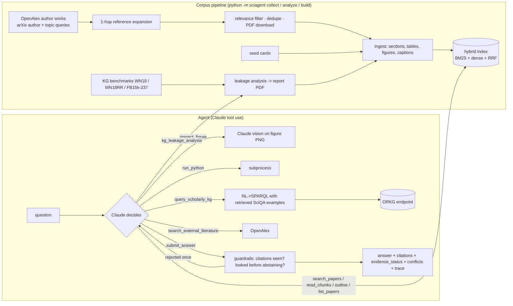

# Architecture and design choices

## Overview

## 1. How the agentic system is structured

- **The model plans; the harness enforces.** Claude chooses which tools to call, how many queries to issue, and when
  to stop (no fixed retrieve-then-generate pipeline). The harness (`agent.py`) only enforces things a model should not
  self-police: a step budget with a forced final call, a structured `submit_answer` contract, and evidence guardrails.
- **Structured final answer.** `submit_answer` returns `answer`, `citations`, `evidence_status`
  (`supported | partially_supported | conflicting | insufficient`), `confidence`, `conflicts`. This makes
  robustness behaviour *measurable* instead of buried in prose.
- **Citation provenance.** Every tool that returns evidence registers the `chunk_id`s it showed the model. A final
  answer citing anything else is rejected with an error tool-result (one self-correction), then stripped and
  downgraded if it persists. This turns fabricated citations from a silent failure into a counted event.
- **Look before abstaining.** An `insufficient` answer with no prior search is rejected once.
- **Tools fail soft.** Tool exceptions, bad arguments, unknown tools and network failures come back to the model as
  JSON errors so it can recover; API rate limits are retried with back-off; any other API failure is captured in the
  result instead of crashing an eval run.
- **Cost/latency.** System prompt and tool schemas are prompt-cached; search results are truncated with a
  `read_chunks` escape hatch; each run records tokens, latency and the full tool trace.
- **Manual loop, no framework.** The loop is ~150 lines on the Anthropic SDK, so every guardrail is visible and unit
  testable with a scripted fake client.

## 2. Corpus collection (automated)

`python -m sciagent collect --author "Sahar Vahdati" --topic "..."` (author optional, topics optional, at least one):

1. **Seed** — the author's works (OpenAlex author → works; arXiv `au:` query) and each topic on both arXiv and OpenAlex.
2. **Expand** — one hop along the references of the author's works, so the papers she builds on or argues with
   (e.g. RotatE for *Loss-Aware Pattern Inference*) are collected without being named.
3. **Dedupe** — by arXiv id, DOI and normalised title; records from different sources are merged, keeping the richest fields.
4. **Filter and rank (no training)** — a paper is kept if it is by the seed author, or matches the topic phrases, or its
   TF-IDF cosine similarity to the topic descriptions is above a threshold; kept papers are ranked by similarity and
   capped (`--max-papers`). Each record stores *why* it was kept and its relevance scores.
5. **Download** — open-access PDFs (arXiv first) with a polite rate limit and retries; a failed download degrades to an
   abstract-only record instead of aborting.
6. **Merge and report** — runs are incremental (new papers merged into `collected.jsonl`), and
   `collect_report.json` records counts per source and stage, PDFs vs abstract-only, and every warning.

Then `python -m sciagent build` ingests and indexes everything. Collection also happens **inside the agent loop**:
when the corpus lacks evidence, the agent can `search_external_literature` and `fetch_paper` (arXiv id or PDF link),
which downloads, ingests and re-indexes that paper mid-run so it can be cited. Users can add a single paper from the
command line (`sciagent add`) or by dropping a PDF on the web page. Google Scholar is not scraped (robots.txt forbids it).

## 3. Processing and indexing — RAG quality

- **Section-aware chunking** (font statistics + numbered-heading regex), ~140-word windows with 30-word overlap,
  never across sections; each chunk is prefixed with `[title > section]` so short chunks stay interpretable.
- **Hybrid retrieval.** BM25 for exact scientific tokens (model names, datasets, numbers) + dense for paraphrase,
  fused with **reciprocal rank fusion** (rank-based, no score calibration). Dense defaults to TF-IDF+SVD so
  everything runs offline; a neural encoder is one env var away.
- **Diversity cap** of 3 chunks per paper in a result list, so multi-paper (and conflicting) evidence surfaces.
- **Measured, not assumed.** On the current small corpus BM25 alone beats hybrid (MRR 0.81 vs 0.73, see
  EVALUATION.md); LSA is a weak dense encoder on a 45-chunk corpus. Hybrid stays the default because it is the safer choice as
  the corpus grows and paraphrased queries dominate, but the harness reports all three so the choice can be revisited
  with a neural encoder. I did not tune fusion weights on the eval questions to avoid overfitting a 21-question set.

## 4. Multimodal handling

- **Tables** are found with PyMuPDF's table finder and extracted **cell by cell** (whole-table extraction
  scrambled decimals: `0.27` → `027 .`, caught by a test), stored as Markdown + caption, and their text is removed from
  body chunks so numbers are not duplicated out of context.
- **Figures** are extracted as PNGs (icons/logos filtered by size), linked to the nearest `Figure N` caption, and the
  caption is indexed. `inspect_figure` sends the image + caption to Claude vision with an instruction to report only
  readable values and say when something cannot be read.
- **Degraded PDFs:** ligatures normalised (NFKC), image-only PDFs flagged `needs_ocr`, corrupt or missing PDFs fall
  back to abstracts — all covered by tests.
- The generated leakage report is a PDF with a known figure and table, so multimodal answers can be checked against
  exact ground truth.

## 5. ML / scientific data-analysis component (no training)

**Inverse-relation test leakage in link-prediction benchmarks** (`sciagent/kg/analysis.py`). On the real WN18,
WN18RR and FB15k-237 files it mines rules `q' ⇒ q` (inverse / symmetric / equivalent relations) from the training
split and evaluates a rule-only model with **filtered ranking** and the **RANDOM tie-breaking protocol** (exact
expectation over random placements, verified against brute force in tests). It reproduces the motivation for WN18RR
from the corpus papers with real numbers (93.2% of WN18 test triples recoverable, rule MRR 0.931 → 0.336 on WN18RR →
≈0 on FB15k-237). ML fundamentals it exercises: train/test leakage, evaluation protocol effects, filtered metrics.

**SciQA NL→SPARQL** (`sciagent/sciqa.py`) with **no training or fine-tuning**: the train split is only an example
pool; examples are chosen by TF-IDF similarity (vocabulary fitted on train questions only). A leakage audit found
**7 test items whose question or gold query also occurs in train** in the official split; they are excluded by default.
A non-LLM nearest-neighbour baseline reaches 74.9% exact match on template-generated questions but 0% on handcrafted
ones — evidence that template questions mostly test example retrieval, so results are always reported per subset with
bootstrap confidence intervals.

## 6. Robustness to missing or conflicting evidence

| Situation | Mechanism | Tested by |
|---|---|---|
| Papers disagree | `evidence_status="conflicting"` + `conflicts` list; prompt requires naming what drives the disagreement | eval q08, q09, q20, q24; test_agent conflicts test |
| Answer not in corpus | must search first, then `insufficient`; may point to external papers without citing them as evidence | eval q15–q17; agent abstain test |
| False premise | prompt rule + eval category | eval q18 |
| Tool cannot do it | errors returned to model | eval q26; tool-error test |
| Fabricated citation | seen-chunk check, retry, strip + downgrade | 3 agent tests |
| Summary vs full text | cards flagged in `get_paper_outline`; prompt tells the model to mention it | – |
| Bad / missing PDFs | abstract fallback, OCR flag | ingest tests |
| Benchmark leakage | SciQA audit; KG leakage analysis | run_sciqa.py; analysis tests |

## 7. Main trade-offs

- Summaries-as-seed-corpus is a sandbox constraint, not a design preference; the collector produces full text.
- Gold evidence is specified as `(paper_id, phrase)` rather than chunk ids, so the eval set survives re-chunking.
- String-matching answer metrics are strict and cheap; the optional LLM judge adds a groundedness score but is itself
  a model, so the strict metrics remain the headline.
